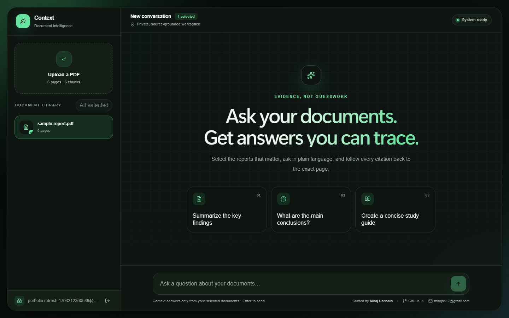
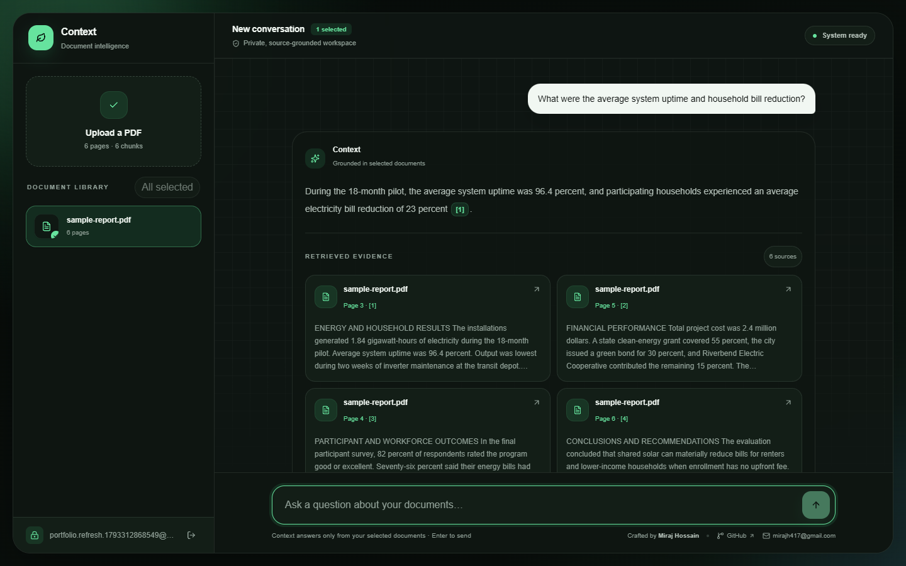
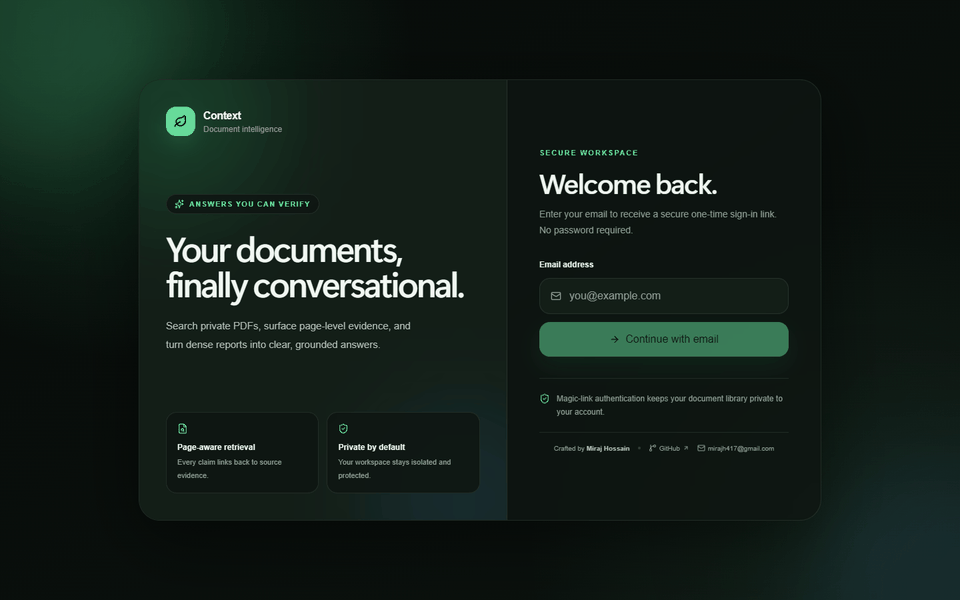

# Context — RAG Document Chat

Context is a production-oriented Retrieval-Augmented Generation application for asking questions about private PDF documents. It extracts and embeds page-aware chunks, retrieves relevant evidence with pgvector, streams answers from Gemini, and links every supported claim to its source page.

> **Live application:** [rag-chat-swart.vercel.app](https://rag-chat-swart.vercel.app)
>
> Upload a text-based PDF, ask a document-specific question, and inspect the page-level evidence behind the answer.

## Portfolio preview

| Workspace | Grounded answer and citations |
| --- | --- |
|  |  |



## Highlights

- Modern, responsive AI workspace with dark/light themes, accessible motion, and polished interaction states
- Passwordless Supabase authentication with protected routes and cookie-based SSR sessions
- Private PDF ingestion without writing uploads to the server filesystem
- Page-aware chunking at approximately 600 tokens with 80-token overlap
- Google Gemini embeddings and streamed answer generation through the Vercel AI SDK
- Supabase Postgres, pgvector HNSW search, Storage, Auth, and row-level security
- Selectable document scope, query rewriting for follow-up questions, and similarity gating
- Inline numbered citations linked to file, page, and source-snippet cards
- Exact refusal when the retrieved context does not support an answer
- Per-user Upstash sliding-window limits for chat and ingestion
- Reproducible 20-question evaluation suite with four unanswerable cases

## Evaluation results

The checked-in evaluation uses a generated six-page community-solar report and the real ingestion, embedding, retrieval, and answering pipeline.

| Metric | Result |
| --- | ---: |
| Top-1 retrieval hit rate | **93.8%** (15/16) |
| Answer correctness | **100.0%** (16/16) |
| Refusal accuracy | **100.0%** (4/4) |
| Average end-to-end latency | **3,005 ms** |
| Provider/runtime failures | **0** |

See [`eval/results.md`](eval/results.md) for per-question answers, source pages, similarities, and latency.

## Architecture

```mermaid
flowchart LR
  subgraph Ingestion[PDF ingestion]
    U1[Authenticated user] -->|PDF up to 8 MB| I[/api/ingest]
    I --> V[Zod and PDF signature validation]
    V --> P[In-memory page extraction]
    P --> C[Page-aware chunking]
    C --> E[Gemini document embeddings]
    E --> DB[(Supabase pgvector)]
    V --> S[(Private Supabase Storage)]
  end

  subgraph Query[Grounded question answering]
    U2[Authenticated user] -->|Question and selected documents| Q[/api/chat]
    Q --> R[Standalone query rewrite]
    R --> QE[Gemini query embedding]
    QE --> M[match_chunks RPC with RLS]
    DB --> M
    M --> T{Similarity at least 0.54?}
    T -->|No| F[Exact refusal]
    T -->|Yes| G[Numbered untrusted context]
    G --> L[Gemini streamed answer]
    L --> UI[Inline citations and source cards]
  end

  AUTH[Supabase Auth] --> I
  AUTH --> Q
  RL[Upstash Redis] --> I
  RL --> Q
```

## Technology

| Layer | Technology |
| --- | --- |
| Web application | Next.js 16 App Router, React 19, TypeScript, Tailwind CSS 4 |
| Interface | Responsive source-owned components, Lucide icons, CSS motion with reduced-motion support |
| AI orchestration | Vercel AI SDK 7, Google Gemini provider |
| Data | Supabase Postgres, pgvector, HNSW cosine index |
| Files and identity | Supabase Storage and passwordless Auth |
| Abuse prevention | Upstash Redis and `@upstash/ratelimit` |
| Validation and parsing | Zod and `unpdf` |
| Evaluation | TypeScript, `pdf-lib`, keyword scoring, retrieval/page assertions |

## Retrieval decisions

- **Page-aware chunks:** each chunk retains its PDF page so citations remain auditable.
- **600-token target and 80-token overlap:** enough context for coherent passages while reducing boundary loss.
- **768-dimensional embeddings:** explicitly configured to match the pgvector column and Gemini embedding output.
- **HNSW cosine search:** low-latency approximate nearest-neighbor retrieval without a training step.
- **Top 6 chunks:** provides enough evidence for synthesis while limiting prompt size.
- **0.54 similarity threshold:** selected from evaluation; the earlier `0.62` threshold rejected two answerable questions.
- **Defense in depth:** RLS scopes database results, selected document IDs narrow retrieval, and server prompts treat document content as untrusted data rather than instructions.

All model names, embedding dimensions, chunk sizes, retrieval count, and threshold live in [`lib/config.ts`](lib/config.ts).

## Local setup

### Prerequisites

- Node.js 22 or newer
- Google Generative AI API key
- Supabase project
- Upstash Redis database

### Install and configure

```bash
git clone https://github.com/MirajHossain22/RAG-chat.git
cd RAG-chat
npm install
```

PowerShell:

```powershell
Copy-Item .env.example .env.local
```

macOS/Linux:

```bash
cp .env.example .env.local
```

Fill `.env.local`:

```dotenv
GOOGLE_GENERATIVE_AI_API_KEY=...
GOOGLE_CHAT_MODEL=gemini-3.1-flash-lite
GOOGLE_EMBEDDING_MODEL=gemini-embedding-001

NEXT_PUBLIC_SUPABASE_URL=...
NEXT_PUBLIC_SUPABASE_ANON_KEY=...
SUPABASE_SERVICE_ROLE_KEY=...

UPSTASH_REDIS_REST_URL=...
UPSTASH_REDIS_REST_TOKEN=...
```

Never expose the Google, service-role, or Upstash secrets through `NEXT_PUBLIC_` variables. `.env.local` is ignored by Git.

### Configure Supabase

1. Open **SQL Editor**, paste [`supabase/migrations/20261029000100_initial_rag_schema.sql`](supabase/migrations/20261029000100_initial_rag_schema.sql), and run it.
2. Under **Authentication → URL Configuration**, use `http://localhost:3000` as the local Site URL.
3. Configure custom SMTP for production email delivery.
4. Under **Authentication → Emails → Magic link or OTP → Source**, use:

```html
<h2>Sign in to Context</h2>
<p>
  <a href="{{ .SiteURL }}/auth/confirm?token_hash={{ .TokenHash }}&type=email">
    Sign in
  </a>
</p>
```

The first successful PDF ingestion creates the private `documents` Storage bucket if it does not exist.

### Run

```bash
npm run dev
```

Open [http://localhost:3000](http://localhost:3000), sign in by email, upload a text-based PDF, and ask a document-specific question.

## Scripts

```bash
npm run dev                 # development server
npm run lint                # ESLint
npm run build               # production build and TypeScript validation
npm run start               # serve the production build
npm run eval                # full 20-question evaluation
npm run eval -- --limit=2   # low-cost evaluation smoke test
```

The evaluator creates an isolated temporary Supabase user and document, saves `eval/results.md`, and deletes the remote test data in a `finally` cleanup block.

## Deployment

The application is deployed from the connected GitHub `main` branch at [rag-chat-swart.vercel.app](https://rag-chat-swart.vercel.app). For a new deployment or fork:

1. Import `MirajHossain22/RAG-chat` into Vercel.
2. Add every variable from `.env.example` to the Production environment.
3. Enable Fluid Compute and select a Function Region close to the Supabase project region.
4. Keep the route-level limits already defined in code: 120 seconds for chat and 300 seconds for ingestion.
5. Deploy, then set the Supabase Site URL and allowed redirect URL to the production Vercel domain.
6. Verify authentication, upload, grounded answers, citations, refusal behavior, deletion, and rate limits.

Use the detailed [Vercel deployment checklist](docs/DEPLOYMENT.md) before publishing the portfolio link.

## Author

Designed and built by **Miraj Hossain**.

- GitHub: [@MirajHossain22](https://github.com/MirajHossain22)
- Email: [mirajh417@gmail.com](mailto:mirajh417@gmail.com)
- Live project: [rag-chat-swart.vercel.app](https://rag-chat-swart.vercel.app)

## Security and hardening

- Uploads are restricted to PDFs no larger than 8 MB and validated by MIME type, extension, and file signature.
- PDFs are processed in memory because Vercel functions have no persistent filesystem.
- Authenticated requests are verified server-side; protected pages use verified Supabase claims.
- RLS prevents users from reading or modifying other users' documents and chunks.
- The private Storage path is namespaced by user ID.
- Retrieved document text is explicitly treated as untrusted data to mitigate prompt injection.
- Chat and ingestion use separate per-user sliding-window limits.
- Production refuses expensive requests when Upstash is not configured.
- Secrets remain server-side and `.env.local` is excluded from version control.

## Known limitations

- Image-only/scanned PDFs require OCR and currently return a clear extraction error.
- The 8 MB and 250-page limits prioritize predictable serverless execution.
- The answer model receives the top six chunks, so document-wide summaries may omit low-ranked sections in very large PDFs.
- Citations identify the PDF page but do not yet highlight exact coordinates inside the rendered PDF.
- Email delivery depends on the configured SMTP provider.
- Evaluation uses a synthetic six-page report; a broader domain-specific benchmark would provide stronger external validity.
- Conversation history is held in the current browser session rather than persisted as named conversations.

## Future improvements

- OCR for scanned documents
- Hybrid BM25 and vector retrieval with reranking
- Persistent conversation history and shareable research sessions
- PDF viewer with citation-region highlighting
- Background ingestion jobs for larger files
- Multi-format ingestion for DOCX, HTML, and Markdown
- Larger human-reviewed evaluation sets and semantic answer judging
- Observability dashboards for latency, refusal rate, and retrieval quality

## Project structure

```text
app/api/              Authenticated ingestion, document, and chat routes
components/           Workspace, sidebar, citations, login, and toast UI
eval/                 Sample PDF generator, 20 Q&A cases, runner, and results
hooks/                Authenticated document-library state
lib/                  Chunking, embeddings, retrieval, prompts, config, Supabase
supabase/migrations/  pgvector schema, RPC, constraints, and RLS policies
proxy.ts              Next.js 16 Supabase session refresh and route protection
```

## Status

**Production ready and deployed.** All eight implementation phases, the evaluation suite, responsive UI redesign, portfolio media, Supabase-backed data layer, Upstash rate limiting, and Vercel deployment are complete.
